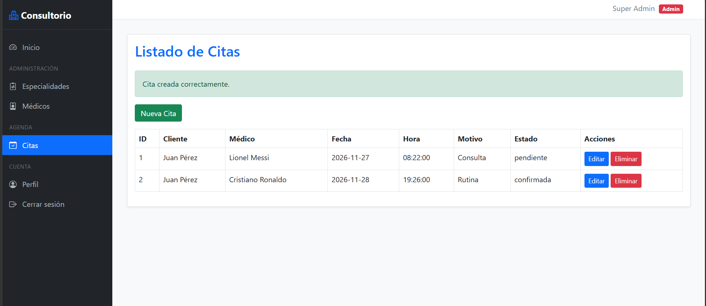
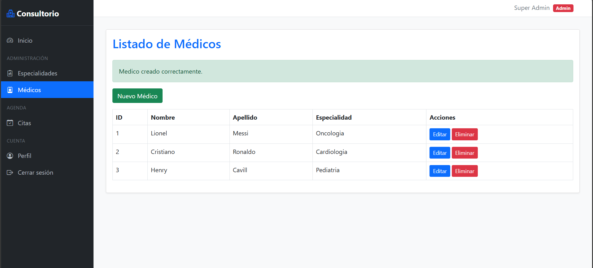
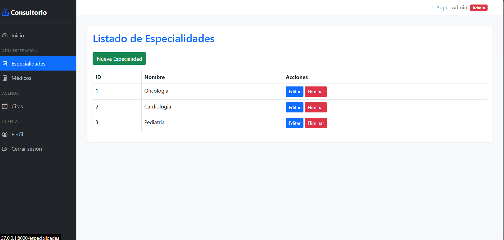

# 🏥 Sistema de Gestión de Citas Médicas

Plataforma Full-Stack diseñada para la administración de un consultorio médico. Permite gestionar especialidades, médicos y agendar citas con un sistema de roles diferenciados.

## ✨ Características Principales
*   **Autenticación y Roles:** Login seguro con diferenciación de roles (Administrador/Recepcionista y Médico) mediante Middlewares.
*   **Gestión de Catálogos:** CRUD completo para Especialidades y Médicos, con validaciones de integridad referencial.
*   **Agenda de Citas:** Creación, edición y control de estado de citas (Pendiente/Confirmada).
*   **Dashboard Interactivo:** Panel de control con resumen de especialidades, médicos y citas del día.
*   **Interfaz de Usuario:** Diseño limpio y responsive con sidebar colapsable y alertas dinámicas.

## 🛠️ Tecnologías Utilizadas
*   **Backend:** PHP / Laravel
*   **Base de Datos:** MySQL
*   **Frontend:** HTML5, CSS3, Bootstrap 5, JavaScript
*   **Herramientas:** Git, Composer, Vite

## ⚙️ Instalación Local
1. Clonar el repositorio: `git clone https://github.com/TU_USUARIO/reservas-consultorio.git`
2. Instalar dependencias: `composer install` y `npm install`
3. Copiar el archivo de entorno: `cp .env.example .env`
4. Generar la clave: `php artisan key:generate`
5. Configurar la base de datos en el `.env` y correr las migraciones: `php artisan migrate --seed`
6. Iniciar el servidor: `php artisan serve`

## 📸 Capturas de Pantalla

| Panel de Control | Listado de Citas |
| :---: | :---: |
|  |  |

| Listado de Médicos | Listado de Especialidades |
| :---: | :---: |
|  |  |